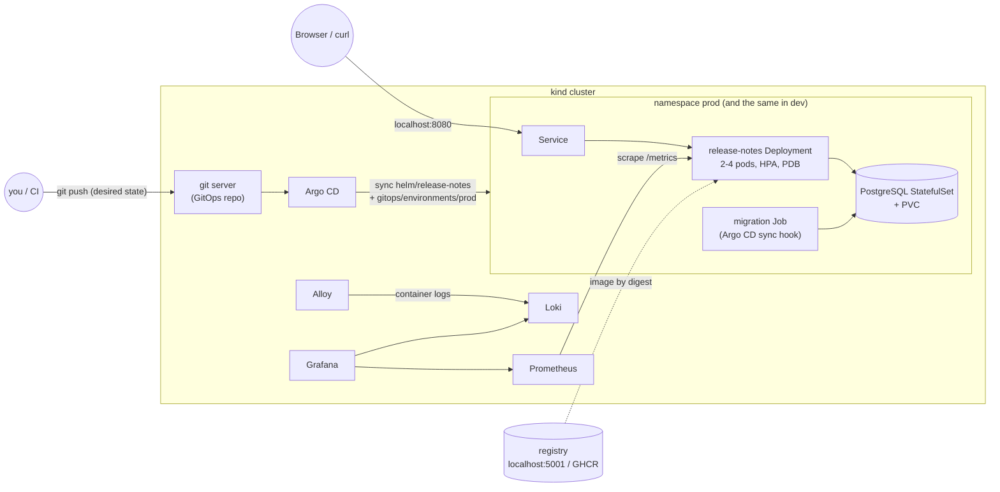

# Release Notes

A tiny internal service for recording what shipped in each release. It runs the way a production
service would: containerised, deployed to Kubernetes by GitOps, observable, and rolled out without
downtime.

- **Service:** FastAPI API + plain HTML/JS UI, PostgreSQL (SQLAlchemy, Alembic migrations), JSON
  logs, Prometheus metrics, liveness/readiness endpoints, unit, integration and chart tests.
- **Platform:** a local [kind](https://kind.sigs.k8s.io/) cluster, one Helm chart for `dev` and
  `prod`, Argo CD, Prometheus, Grafana, Loki and Alloy, all brought up by **`make up`**.
- **Delivery:** GitHub Actions (lint → test → validate → build → scan → publish to GHCR → commit
  digest). Build once, promote the same digest to prod by pull request, and roll back by restoring
  the previous digest.

Trade-offs and limitations are in [DECISIONS.md](DECISIONS.md). What was actually executed, with
numbers, is in [docs/verification.md](docs/verification.md).

## Architecture



**Runtime.** Each environment is a namespace containing the API Deployment, a Postgres
StatefulSet with its own PVC and generated credentials, a NetworkPolicy that only lets the API and
migration pods reach Postgres, and (prod only) an HPA (2–4 replicas) and a PodDisruptionBudget. The
API's `/health` (liveness) never touches the database, while `/ready` (readiness) queries the
`releases` table. A database outage therefore takes pods out of the Service without restarting
them.

**Delivery.** Argo CD renders the same chart with
`gitops/environments/<env>/{values,image}.yaml`. `image.yaml` holds the image **digest** and is the
only file automation changes. Every deploy, promotion and rollback is therefore a one-file Git
commit, and Argo CD reconciles it. There are two front ends to the same mechanism:

| | Image registry | GitOps repo Argo CD watches | Who writes `image.yaml` |
|---|---|---|---|
| **Local (this README)** | `localhost:5001` (registry container) | in-cluster git server, a mirror of your checkout | `make release / promote / rollback` (commit + push to the mirror) |
| **GitHub** | GHCR | the GitHub repo | `ci.yml` (dev, on merge to main), `gitops-change.yml` (prod, via PR) |

The local loop exists so anyone can run the full GitOps flow from a clone, without push access to
a GitHub repo or a GHCR account. Pointing Argo CD at GitHub only changes `repoURL`
([below](#cicd-on-github)).

**Observability.** Prometheus discovers pods via `prometheus.io/*` annotations and keeps
`namespace`/`pod` labels, so dev and prod are separate series. kube-state-metrics adds replica
availability. Alloy tails container logs via the Kubernetes API and sends them to Loki, promoting
the JSON `level` field to a label. Grafana is provisioned with both data sources and a *Release
Notes* dashboard.

## Prerequisites

| Tool | Tested with | Notes |
|---|---|---|
| Docker (Desktop or Engine) | 29.4 | give it **≥ 6 GB RAM** (8 GB comfortable) and 4 CPUs |
| kind | 0.33 | node image pinned to Kubernetes 1.35.1 |
| kubectl | 1.35 | |
| Helm | 4.1 (3.x also works) | charts are installed with `--repo`, no `helm repo add` needed |
| git, curl, openssl, make | any recent | scripts are bash 3.2 compatible (stock macOS) |
| [uv](https://docs.astral.sh/uv/) | 0.12 | only for running tests/lint locally |

Free host ports: 8080, 8081, 3000, 8090, 8418 (cluster) and 5001 (registry). They bind to
`127.0.0.1` only. The running stack uses about 4 GB of memory and about 6 GB of disk for images.

## Quick start

```bash
make up        # cluster, registry, platform, both environments (~4 min measured; longer on first image pulls)
make status    # desired state in git vs what Argo CD / Kubernetes report
make e2e       # 38 end-to-end checks against the running stack
```

`make up` is idempotent; rerun it to converge after a failure. It:

1. checks prerequisites, Docker memory and free ports;
2. starts a local registry and a kind cluster wired to it, then creates the namespaces (`dev`/`prod`
   enforce the *restricted* Pod Security Standard);
3. generates per-environment DB credentials and the Grafana admin password as Kubernetes Secrets
   (never written to git);
4. deploys the in-cluster git server and installs Argo CD, Prometheus, Loki, Alloy, Grafana and
   metrics-server (pinned chart versions in `infrastructure/versions.env`, installed in parallel);
5. checks that the image digests in `gitops/environments/*/image.yaml` exist. On a fresh clone they
   don't (they point at the author's registry), so it **builds the current commit once and commits
   the digest** (`deploy(bootstrap): ...`). That way Argo CD still deploys from git;
6. pushes your branch to the in-cluster git repo, registers the two Argo CD Applications, and waits
   until both are *Synced* **and** *Healthy* at that commit, then smoke-tests both environments.

Only committed changes are deployed (that's GitOps); `make up` warns about uncommitted changes.

### Access

| What | URL | Credentials |
|---|---|---|
| App, prod | http://localhost:8080 | – |
| App, dev | http://localhost:8081 | – |
| Grafana | http://localhost:3000 → *Dashboards → Release Notes* | anonymous read-only; admin password printed by `make up` |
| Argo CD | http://localhost:8090 | `admin` / printed by `make up` |
| API docs | http://localhost:8080/api/docs | – |

### Using the API

```bash
curl -s -X POST localhost:8080/api/releases -H 'Content-Type: application/json' \
  -d '{"version":"2.4.0","description":"New export button; fixed login timeout"}'   # 201
curl -s 'localhost:8080/api/releases?limit=20'      # newest first
curl -s localhost:8080/version                       # {"version":"1.0.0","git_sha":...,"environment":"prod"}
```

A duplicate version returns `409`, invalid input `422`, and a database outage `503` with
`Retry-After`. Every response carries `X-Request-ID` and `X-App-Version`.

## Tests and validation

```bash
make lint       # ruff (lint + format), shellcheck
make test       # unit + integration (throwaway Postgres container, real Alembic migrations) + chart policy tests
make validate   # helm lint/template for dev and prod + kubeconform (K8s 1.35 + Argo CD CRD schemas)
make e2e        # against the running cluster: API, UI, Argo CD, Prometheus, Loki, Grafana, pod hardening
```

- **Unit** (no DB): validation rules, liveness vs readiness under a DB outage, 503 without leaking
  connection details, request-ID handling, metric label cardinality, JSON log fields.
- **Integration** (Postgres): migrations up/down, create/list, deterministic ordering, `409` on
  duplicates, **8 concurrent duplicate POSTs → exactly one `201`**, persistence across app
  instances, readiness failing when the schema is missing.
- **Chart** (`helm template` + assertions): no Secrets rendered, digests pinned, probes,
  requests/limits, restricted security context, grace period > preStop + drain, rollout strategy,
  sync-wave ordering, per-environment replicas, HPA and log levels.

## Delivery: release, promote, roll back

All three are git commits that change a single `image.yaml`. Argo CD does the deploying.

```bash
make release VERSION=1.1.0   # build the current commit once, push, set dev's digest, wait for dev Healthy
make promote                 # gate: dev Synced/Healthy and serving that digest -> copy the same digest to prod
make rollback ENV=prod       # restore prod's previous digest from git history (only image.yaml changes)
TO=<git-rev> make rollback ENV=prod   # ...or the image.yaml as of a specific commit
```

`make rollback` reverts the **image only**. Schema migrations are not rolled back; they are
written to be backward compatible (expand/contract), so the previous image runs against the newer
schema. Data is never rolled back; that would be a restore from backup.

### CI/CD on GitHub

- **`.github/workflows/ci.yml`** runs on every PR and push to `main`:
  1. lint (ruff, shellcheck, hadolint, actionlint);
  2. tests against a Postgres service container (`REQUIRE_DB=1`, so integration tests fail rather
     than skip);
  3. `validate-manifests.sh` and a Trivy config scan;
  4. an image build tagged `<version>-<sha7>`, a smoke test (read-only, non-root, `/version`,
     `alembic history`) and a Trivy vulnerability scan (fails on fixable HIGH/CRITICAL).

  On `main` only, after all of that, **publish** pushes a multi-arch image (with SBOM and
  provenance) to `ghcr.io/<owner>/release-notes` and commits its digest to
  `gitops/environments/dev/image.yaml`. That commit is made with `GITHUB_TOKEN`, so it does not
  trigger another run, and `paths-ignore` skips image-only commits anyway.
- **`.github/workflows/gitops-change.yml`** (manual) opens a **pull request** that either promotes
  dev's digest to prod or rolls an environment back. It reuses `scripts/promote.sh` /
  `scripts/rollback.sh` with `GITOPS_ONLY=1`. Merging the PR is the approval, and Argo CD deploys.

Repository settings this needs: Actions allowed to *create pull requests* and to write
`contents`/`packages`. The GHCR package must be **public** (or the cluster needs an
`imagePullSecret`). If `main` is protected against direct pushes, change the dev step to open a PR
as well. To have Argo CD track GitHub instead of the local mirror, change `repoURL` (and
`sourceRepos`) in `gitops/argocd/applications.yaml` to your repository URL.

## Zero-downtime rollout

```bash
make demo-rollout            # or VERSION=1.2.0 make demo-rollout
```

1. Releases the next version to dev (build once) and waits for dev to be Healthy.
2. Starts the **traffic generator as a Job inside the cluster**, against
   `http://release-notes.prod.svc.cluster.local`. No port-forward, so it sees kube-proxy and
   endpoint behaviour as a real client would. By default it sends about 40 req/s with a new
   connection per request and a 5 s timeout, and classifies each request as `ok`, `http_error`,
   `timeout` or `conn_error`.
3. Promotes the same digest to prod, follows `kubectl rollout status` and Argo CD health, and waits
   until the old pods have drained and terminated.
4. Prints the generator's report (totals, failure breakdown, p50/p95/p99, and first/last time each
   version was seen) and **exits non-zero if any request failed**.

Measured: **6,002 requests, 0 failed** during 1.0.0 → 1.1.0 (details in
[docs/verification.md](docs/verification.md)). The version switch is visible in the UI's header
badge, `/version` and the `X-App-Version` header. All of these come from build arguments baked into
the image.

You can also measure manually: run `make traffic ENV=prod DURATION=180` in one terminal and
`make release VERSION=x` / `make promote` / `make rollback ENV=prod` in another. Extra generator flags
(`--keepalive`, `--rps`, `--max-failures`, see `scripts/traffic/traffic.py`) go through the script, e.g.
`scripts/traffic.sh prod 180 --rps 80`.

What makes it work: `maxSurge: 1, maxUnavailable: 0`; readiness gates traffic and `minReadySeconds: 5`;
a `preStop` sleep of 5 s so endpoint removal propagates before shutdown; uvicorn drains in-flight
requests on SIGTERM for up to 20 s; `terminationGracePeriodSeconds: 35` > 5 + 20 (a chart test
enforces this); `progressDeadlineSeconds: 120` turns a stuck rollout into a visible failure.

## Failure scenarios

| Command | What happens | Measured |
|---|---|---|
| `make demo-broken-rollout` | deploys an image whose `/ready` always fails, under traffic | new pod never Ready, 4 old pods keep serving, `ProgressDeadlineExceeded`, Argo CD **Synced/Degraded**; auto `make rollback` → Healthy; **0 of ~9,600** requests failed |
| `make demo-pod-kill` | `kubectl delete pod` on one prod pod, under traffic | replica restored; **0 of 2,400** failed |
| `CRASH=1 make demo-pod-kill` | SIGKILL of the app process (no preStop, no drain) | kubelet restarts the container; **4–8 of ~1,800** failed (connection refused, a few ms window) |
| `make demo-db-restart` | deletes the Postgres pod, under traffic | same PVC re-attached, data intact, back in about 2–3 s, no API restarts (liveness ignores the DB); **48–80 of ~3,600** got `503`. Postgres is a single point of failure |
| `make rollback ENV=prod` | GitOps rollback under traffic | about 35 s to Healthy; **0 of 4,000** failed |
| `scripts/traffic.sh prod 150 --keepalive --max-failures 1000000` during a rollout | persistent connections, no client retry | **11 of 6,003** failed (`RemoteDisconnected` when a draining pod closes idle connections); see DECISIONS.md |

The demos only act on the local kind cluster: `scripts/lib.sh` pins every kubectl call to
`--context kind-release-notes`.

## Logs and metrics

- **Grafana → Release Notes**: available replicas, request rate, 5xx ratio, pods per running
  version (watch it flip during a rollout), latency p50/p95/p99, status distribution, scrape health,
  log volume by level, and an application log panel. *Environment* and *Log level* variables filter
  every panel.
- **Loki** (Grafana → Explore → Loki):
  ```logql
  {namespace="prod", app="release-notes", component="api", level="ERROR"}
  {namespace="dev", pod=~"release-notes-.*"} | json | route="/api/releases" | status >= 400
  ```
- **Prometheus** (Grafana → Explore):
  ```promql
  sum by (namespace, status) (rate(http_requests_total{route!~"/health|/ready|/metrics"}[1m]))
  histogram_quantile(0.95, sum by (namespace, le) (rate(http_request_duration_seconds_bucket[5m])))
  sum by (namespace, version) (release_notes_build_info)
  ```

Log lines are JSON with `timestamp, level, logger, message, service, version, env, request_id,
method, route, path, status, duration_ms` (and `exc_type`/`exc_info` on errors). Probe and scrape
requests log at DEBUG, so they appear in dev but not in prod (INFO). Errors are always visible.
Credentials and connection strings are never logged.

The traffic generator, not Grafana, is the source of truth for downtime. Application metrics can't
count requests that never reached a pod (refused connections, timeouts).

## Repository layout

```text
app/                      FastAPI service (config, db, models, schemas, api, observability) + static UI
alembic/                  migrations (run by the Argo CD sync-hook Job)
tests/                    unit/, integration/ (Postgres), chart/ (helm template policy tests)
Dockerfile                multi-stage, non-root, read-only-rootfs compatible
helm/release-notes/       the one chart (API, Postgres, migration Job, HPA/PDB, NetworkPolicy)
gitops/environments/      per-environment values.yaml + image.yaml (desired state)
gitops/argocd/            AppProject + the two Applications
infrastructure/           kind config, namespaces, git server, platform chart values, dashboard
scripts/                  up/down/status, release/promote/rollback, traffic, verify, demo/*
.github/workflows/        ci.yml, gitops-change.yml
docs/verification.md      what was executed and the results
```

## Clean up

```bash
make down    # deletes the kind cluster: ALL data (both Postgres PVCs, metrics, logs, git mirror) is gone
make clean   # also removes the local registry container + its volume and the git remote
```

## Known limitations

- Postgres is a single instance per environment: persistent, but not HA and not backed up.
- Secrets are generated by `make up` and live only in the cluster. A real setup would use External
  Secrets or Sealed Secrets.
- No TLS, Ingress, alerting rules or SLOs. Grafana allows anonymous read-only viewing on localhost.
- The in-cluster git server accepts anonymous pushes. It's reachable only from inside the cluster and
  from `127.0.0.1`.
- The GitHub workflows are validated with actionlint and their shell logic is exercised locally, but
  they have **not been run on GitHub** for this submission (see docs/verification.md).

## Troubleshooting

| Symptom | Fix |
|---|---|
| `Host ports already in use` | stop whatever uses 8080/8081/3000/8090/8418, or `make down` an old cluster |
| a platform chart failed | `make up` again; logs are in `.local/logs/helm-<name>.log` |
| app stuck `OutOfSync`/`Progressing` | `make status`; `kubectl -n argocd get application release-notes-prod -o yaml`; check the migration Job logs: `kubectl -n prod logs job/release-notes-migrate` |
| changes not deployed | commit them; `make release` / `make promote`, or rerun `make up` to push HEAD to the GitOps repo |
| pods `ImagePullBackOff` after `make clean` | the registry was wiped; `make up` rebuilds and records new digests |
| Docker out of memory | raise Docker's memory to 6–8 GB |
